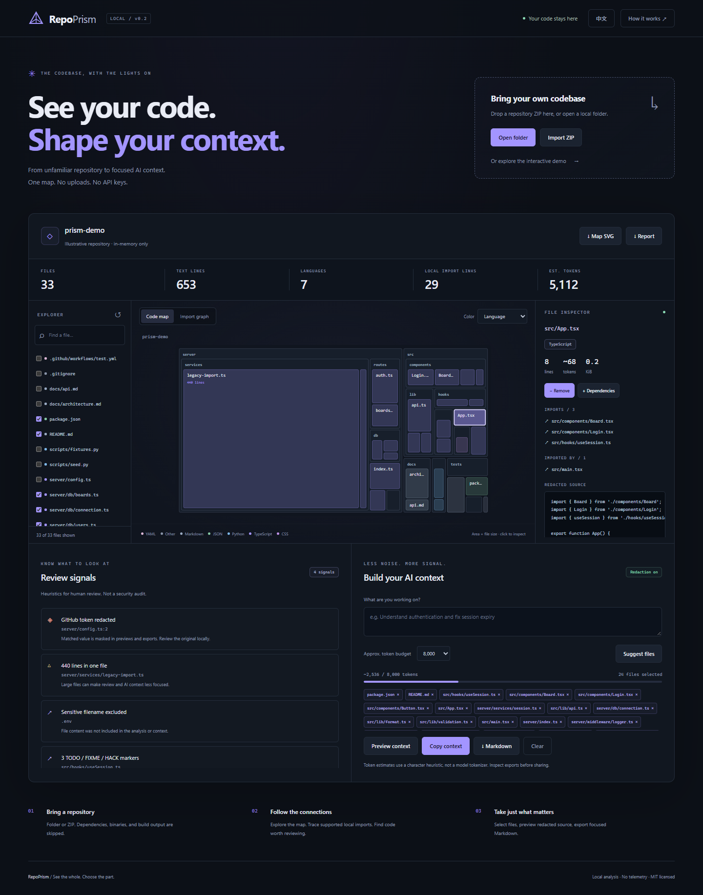

# RepoPrism

**看懂整个仓库，选对每一份上下文。**

代码地图、导入关系、审查线索和 AI 上下文工作台，放在一个完全本地分析的小工具里。

[English](README.md) · [选题研究](docs/RESEARCH.zh-CN.md) · [发布说明](docs/PUBLISHING.md) · [参与贡献](CONTRIBUTING.md)



接手一个陌生仓库，或者准备让 AI 帮你修改代码，第一步往往是：找到相关文件。RepoPrism 让你先看清结构和导入关系，再挑选代码，导出聚焦的上下文。

## 已经能做什么

- **交互代码地图**：文件面积对应源码大小；支持进入文件夹、按路径搜索，以及按语言、上下文大小、审查线索着色。
- **静态导入关系图**：使用 Babel 解析 JS / TS 的语法，覆盖多行导入、类型导入和声明文件；支持常见 `paths` / `baseUrl` 别名及本地配置继承。Python 使用独立的启发式解析。查看依赖与调用方，将两层依赖一起加入上下文。
- **可核查的审查线索**：大文件、共享模块、导入循环、TODO 标记、常见凭据模式。它们是人工检查的起点，不是安全或代码质量评分。
- **AI 上下文选择**：输入任务、设置估算预算、获得规则推荐；查看被预算排除的候选，手动调整文件，预览完整的遮盖后 Markdown，再复制或导出。
- **结果导出**：源码上下文、元数据报告，以及可放入文档的独立 SVG 地图。
- **本地分析**：Web Worker 负责导入和分析；无需账号、API Key，不上传源码，无遥测。仓库仅在内存中保留。
- **生产版离线可用**：首次成功访问并缓存完成后，可断网重载并导入仓库。缓存的是程序本身，不是你的源码。

默认演示文件是原创的说明性数据，不代表真实用户或生产项目；其中包含故意构造的假 token，用于展示遮盖效果。

## 本地运行

**只想试用？** 下载发布文件 `repoprism-portable-v0.2.0.html`，双击打开即可。程序、样式和分析线程都内嵌在一个文件中，不需要安装、服务器或网络。独立版已在 Chromium / Edge 验证；浏览器若限制本地文件，请使用托管版本。

如果要开发源码：

需要 Node.js 22.12+ 或 24+。

```bash
npm ci
npm run dev
```

打开终端打印的本地地址。页面默认加载交互示例，也可直接打开文件夹或导入 ZIP。

生产版本与离线缓存：

```bash
npm run build
npm run preview
```

`dist/` 可以部署到静态托管服务。源 `index.html` 需要服务器，生成的 `dist/repoprism.html` 才是可双击的独立版。网页 ZIP 也无需安装 Node 依赖，解压后可通过 HTTP 服务打开。

## 一个真实用途

想修复会话过期问题：

1. 导入项目，搜索 `session`。
2. 查看认证入口及其调用方。
3. 点击“本地依赖”，加入相邻的相关代码。
4. 输入任务，如“找出为什么会话比预期提前过期”。
5. 调整选择，检查遮盖后的源码，导出 Markdown 到你使用的 AI 工具。

推荐算法使用任务词匹配、入口、共享模块及导入关系；通过一个明确的小词表，把“认证”“会话过期”等常见中文任务词映射到英文标识符。没有调用 LLM，也不能代替人工判断。无任务关键词匹配时会说明原因，放不进预算的候选会列出来。预算包括任务、路径和 Markdown 包装；手动选择超预算时会提示，不会静默截断源码。

## CLI

CLI 与网页共用分析引擎，不执行被分析项目的代码或配置。

```bash
npm run analyze -- ../my-project --task "authentication session" --budget 8000
npm run analyze -- ../my-project --include src/auth.ts,README.md
npm run analyze -- ../my-project --format report --out report.md
node bin/repoprism.js ../my-project --format json
```

JSON 仅包含元数据，不包含源码。`--out` 只创建新文件，拒绝覆盖已有文件。本项目尚未发布到 npm，没有承诺 `npx repoprism` 可用。

## 与已有项目的关系

[Repomix](https://github.com/yamadashy/repomix)、[Gitingest](https://github.com/coderamp-labs/gitingest)、[code2prompt](https://github.com/mufeedvh/code2prompt) 已经覆盖了仓库打包需求。RepoPrism 重点在**导出前的可视化理解与人工选择**，适合作为成熟工具的轻量补充。

## 当前边界

- 支持 UTF-8 文本，最多 5,000 个可分析文件；单文件 2 MiB，总文本 50 MiB，输入 ZIP 最多 50 MiB。
- 跳过依赖、构建目录、二进制、锁文件、压缩产物、`.env` 和常见私钥文件名；规则见 `src/core.js`。
- 支持根目录 `.gitignore` 的常见子集，不支持嵌套文件、转义规则、字符类及完整 Git 优先级；默认排除规则不能被重新包含。
- JS / TS 使用 Babel 语法解析，HTML / Vue / Svelte 分析 script 块；Python 仍为启发式。支持最近的 `tsconfig.json` / `jsconfig.json`、JSONC、`paths`、`baseUrl` 和相对路径 `extends`，不支持项目引用、包配置继承、动态表达式及 Rust / Go 导入。解析失败和未找到的本地导入会显示线索。
- 关系图最多显示当前筛选中的 120 个文件，优先保留当前文件及其邻居，再按连接数排序；完整分析与报告仍覆盖所有可分析文件。
- 导入可以取消，当前仓库与选择会保留；超过 60 秒的任务会停止。ZIP 在读取字节前检查大小。
- Token 是字符估算，不是模型精确分词。文本行数包含注释、空行、配置和文档。
- 凭据遮盖针对常见模式，存在漏报和误报。分享前仍需检查。不是完整安全审计。
- 刷新会清除导入的仓库与选择。离线缓存只存程序资源，不保存用户源码。

详细数据流见 [SECURITY.md](SECURITY.md)。

## 验证与部署

```bash
npm run check
npm test
npm run test:e2e
```

浏览器测试运行生产构建，覆盖真实导入、遮盖、文件选择、移动端布局、断网重载后的导入、仓库子路径托管，以及独立文件在零 HTTP 请求下的导入与导出。Windows 使用已安装的 Edge；Linux / macOS 先运行 `npx playwright install chromium`。

已经准备 GitHub Actions 检查与手动触发的 GitHub Pages 部署流程。说明见 [PUBLISHING.md](docs/PUBLISHING.md)。源码和文档已经准备好，未伪造已上线网址、用户数或 Star 数。

欢迎提供不含凭据的最小复现，帮助改善导入解析、文件过滤、地图可读性和推荐结果。项目引用配置选择、可选精确分词器和 Python AST 解析属于后续计划。已实现的改进见 [CHANGELOG.md](CHANGELOG.md)。

MIT 许可证。运行时使用 fflate、Babel parser 和 jsonc-parser，均为 MIT，完整许可证随发布文件附带。前一版夜航保存在忽略的本地归档中，不进入正式源码包。
